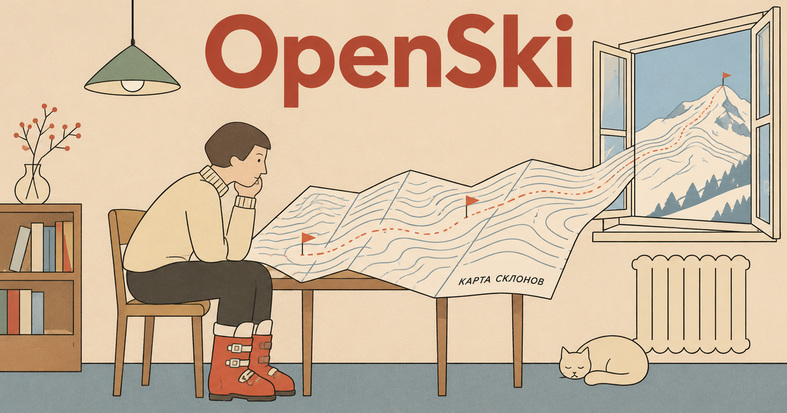
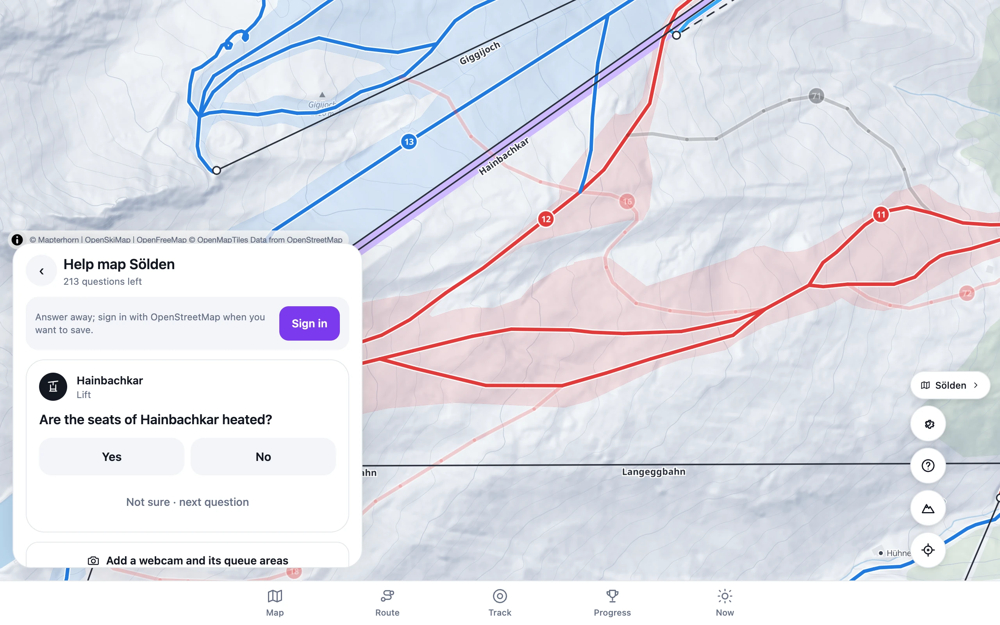
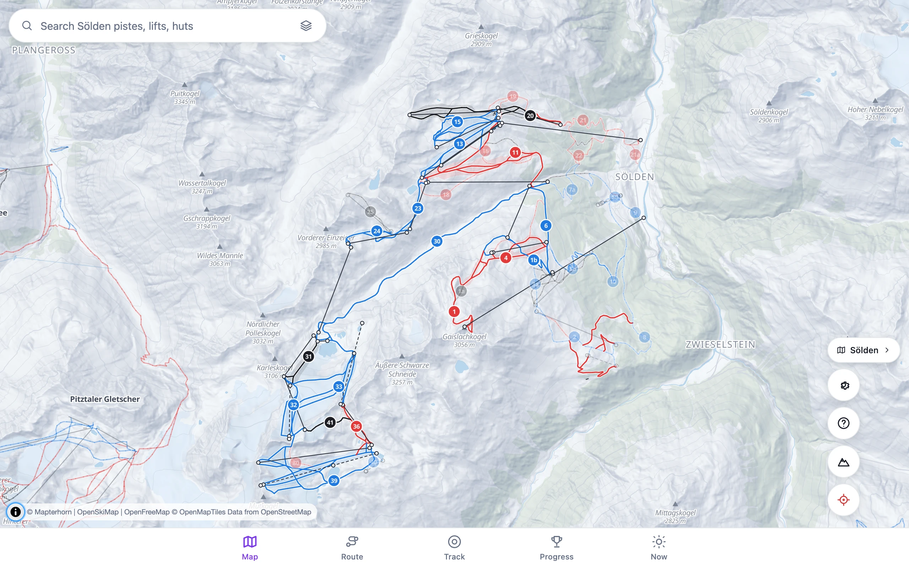
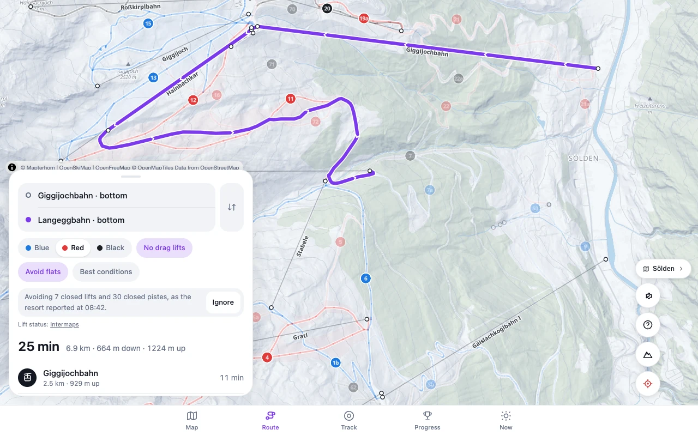
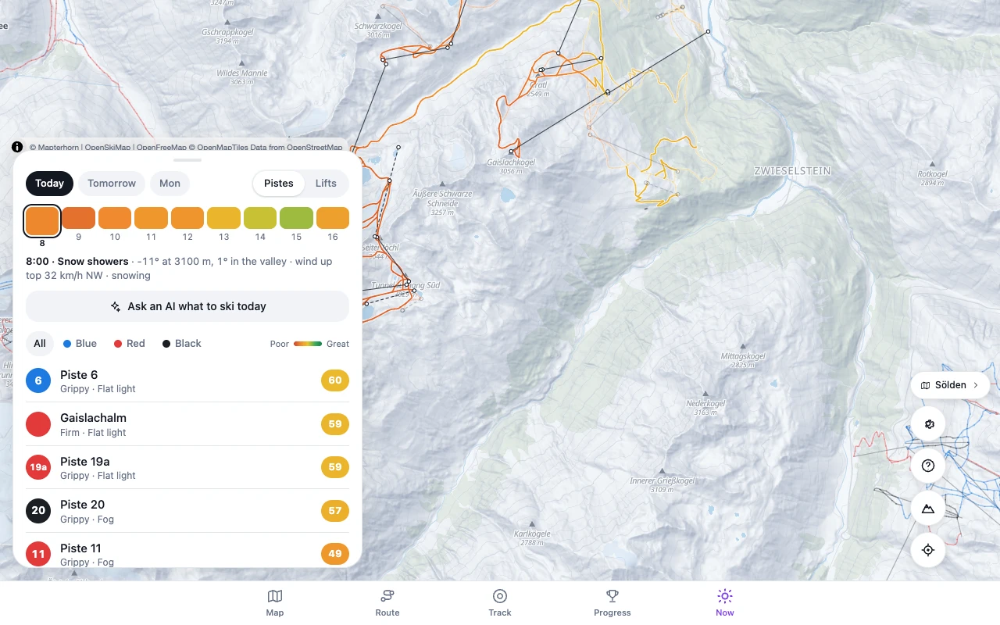

# openski.org

**A free ski map that skiers and snowboarders can improve through [OpenStreetMap](https://www.openstreetmap.org/).** The catalogue comes from [OpenSkiData](https://openskidata.org/), the dataset behind [OpenSkiMap](https://openskimap.org/). Explore 3,920 mapped ski areas and download a resort before heading offline.

[**Help map a ski area**](https://openski.org/soelden/questions) · [Browse all ski areas](https://openski.org/resorts)



- **Improve OpenStreetMap from the slopes.** Spot a missing piste colour, grooming detail or lift feature? Answer a quick map question or open a lift or piste to edit its details. Review the changes and save them under your OpenStreetMap account so other maps and apps can use them too.
- **Piste conditions by the hour.** Estimates for snow surface, sun, flat light and wind.
- **Lift queues.** Fifteen ski areas have counting regions configured on provider webcams. Check the count against the source picture when the camera is available, or contribute a camera.
- **Routes for skis and snowboards.** Set your maximum piste difficulty, skip drag lifts and prefer routes with fewer flat stretches.
- **Follow your day.** See your position, record tracks and keep track of which pistes and lifts you’ve ridden. Fade ridden runs and, where live status is available, closed runs and lifts.

## Screenshots

| Answer a map question for OpenStreetMap                                                                                                              | Explore the piste map                                                                                                                 |
| ---------------------------------------------------------------------------------------------------------------------------------------------------- | ------------------------------------------------------------------------------------------------------------------------------------- |
|                 |        |
| **Plan a route**                                                                                                                                     | **Check piste conditions by the hour**                                                                                                |
|  |  |

## Run it

```sh
cp .env.example .env
bun install --frozen-lockfile
bun run dev    # http://127.0.0.1:5173
```

A SvelteKit app on Cloudflare Workers. More in the docs:

- [Development](docs/development.md): scripts, local setup, debugging URLs
- [How it works](docs/how-it-works.md): conditions model, queue counting, lift status, OSM edits
- [Data](docs/data.md): sources, licences, rebuild pipeline, the people-detection model
- [Deployment](docs/deployment.md): Cloudflare setup, settings, running your own instance

## License

The source is **AGPL-3.0-only** ([LICENSE](LICENSE)), matching the shipped YOLO11n model. Data keeps its
own terms: resort and piste data is ODbL from OpenStreetMap via OpenSkiData; weather (Open-Meteo) and
parts of the elevation data are CC BY 4.0; webcam pictures, lift status and piste maps stay with their
providers and are credited with a link wherever they show. Full credits are in [NOTICE](NOTICE).
